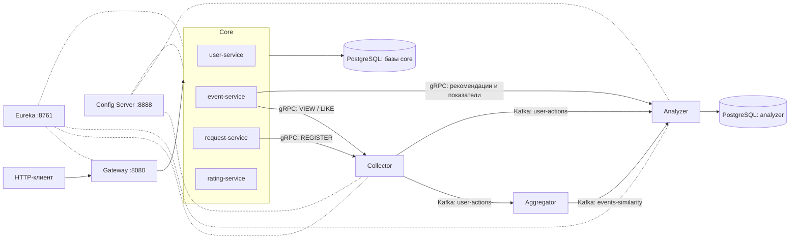

# Explore With Me

**Explore With Me** — микросервисное приложение для поиска и публикации событий, записи на мероприятия и получения персональных рекомендаций.

В проекте реализованы управление пользователями, категориями, подборками и событиями, обработка заявок на участие, отдельный сервис оценок и система рекомендаций на основе действий пользователей.

## Содержание

- [Возможности](#возможности)
- [Технологии](#технологии)
- [Архитектура](#архитектура)
- [Структура репозитория](#структура-репозитория)
- [Локальный запуск](#локальный-запуск)
- [Основные API](#основные-api)
- [Как работают рекомендации](#как-работают-рекомендации)
- [Сборка и проверки](#сборка-и-проверки)
- [Конфигурация и диагностика](#конфигурация-и-диагностика)

## Возможности

- **События:** создание, редактирование, модерация и публикация; публичный поиск с фильтрацией и пагинацией.
- **Пользователи и справочники:** управление пользователями, категориями событий и тематическими подборками.
- **Участие:** создание заявок на участие, подтверждение и отклонение заявок, учёт лимита участников.
- **Реакции и рейтинг (дополнительная функциональность):** лайки/дизлайки через отдельный `rating-service`, выборка избранных событий, рейтинг и административная статистика реакций.
- **Рекомендации:** сбор просмотров, регистраций и лайков, вычисление похожести событий, персонализированная выдача и расчёт показателей взаимодействий.

## Технологии

| Направление | Стек |
| --- | --- |
| Язык и сборка | Java 21, Maven (multi-module) |
| Backend | Spring Boot 3.3, Spring Web, Spring Data JPA, Spring Validation |
| Микросервисы | Spring Cloud Config, Netflix Eureka, Spring Cloud Gateway, OpenFeign |
| База данных | PostgreSQL |
| Событийная обработка | Apache Kafka, Apache Avro |
| Межсервисный RPC | gRPC, Protocol Buffers |
| Маппинг и служебный код | MapStruct, Lombok |
| Развёртывание | Docker, Docker Compose |
| Проверки | Maven, Checkstyle, GitHub Actions |

## Архитектура



- **Gateway** — единая HTTP-точка входа, маршрутизирует запросы к сервисам через Eureka.
- **Config Server** — централизованно загружает YAML-конфигурации из `infra/config-repo/`.
- **Collector** — принимает действия пользователей по gRPC и отправляет Avro-сообщения в Kafka.
- **Aggregator** — читает действия из Kafka и вычисляет похожесть пар событий.
- **Analyzer** — сохраняет действия и похожесть в PostgreSQL, выдаёт рекомендации по gRPC.
- **Stats Server** — отдельный сервис статистики HTTP-запросов (`/hit`, `/stats`); сохранён наряду с новой рекомендательной подсистемой.

> `rating-service` с реакциями `LIKE/DISLIKE` и новый механизм `PUT /events/{eventId}/like` — разные API. Второй отправляет действие в рекомендательную систему и требует подтверждённого участия в событии.

## Структура репозитория

```text
.
├── core/
│   ├── event-service/        # события, категории и подборки
│   ├── request-service/      # заявки на участие
│   ├── user-service/         # пользователи
│   └── rating-service/       # реакции и рейтинг
├── stat/
│   ├── collector/            # приём действий (gRPC -> Kafka)
│   ├── aggregator/           # вычисление похожести
│   ├── analyzer/             # персональные рекомендации
│   ├── stats-proto/          # protobuf/gRPC-контракты
│   ├── stats-avro/           # Avro-схемы сообщений
│   ├── stat-client/          # gRPC-клиенты
│   ├── stat-dto/             # DTO статистики
│   └── stats-server/         # статистика HTTP-запросов
├── infra/
│   ├── discovery-server/     # Eureka
│   ├── config-server/        # Spring Cloud Config
│   ├── gateway-server/       # HTTP API Gateway
│   └── config-repo/          # централизованные конфигурации
├── docker-compose.yml
└── pom.xml
```

## Локальный запуск

### Требования

- JDK **21**;
- Maven **3.9+**;
- Docker и Docker Compose.

Все команды ниже выполняются **из корня репозитория**.

### 1. Получить проект и собрать JAR-файлы

```bash
git clone https://github.com/Ynausi/java-plus-graduation.git
cd java-plus-graduation
git checkout recommendations
mvn clean package -DskipTests
```

### 2. Запустить Kafka и PostgreSQL

```bash
docker compose up -d kafka   users-db requests-db events-db ratings-db stats-db analyzer-db

# Создать Kafka-топики из docker-compose.yml
docker compose run --rm kafka-init-topics
```

При первом запуске Kafka может ещё инициализироваться. Если команда создания топиков завершилась ошибкой подключения, проверьте `docker compose logs kafka` и повторите её после готовности брокера.

Для работы используются следующие локальные порты:

| Компонент | Порт на хосте |
| --- | --- |
| API Gateway | `8080` |
| Eureka | `8761` |
| Config Server | `8888` |
| Kafka | `9092` |
| stats-db | `6642` |
| users-db | `6644` |
| requests-db | `6645` |
| events-db | `6646` |
| ratings-db | `6647` |
| analyzer-db | `6648` |

**Важно:** `docker-compose.yml` содержит инфраструктурные и `stat`-контейнеры, но **не описывает запуск всех четырёх `core`-сервисов**. Для воспроизводимого локального сценария ниже инфраструктура запускается в Docker, а Java-сервисы — на хосте.

### 3. Запустить инфраструктурные Java-сервисы

В отдельных терминалах, последовательно дожидаясь старта зависимости:

```bash
# Терминал 1: Eureka
java -jar infra/discovery-server/target/discovery-server-0.0.1-SNAPSHOT.jar

# Терминал 2: Config Server
java -jar infra/config-server/target/config-server-0.0.1-SNAPSHOT.jar
```

Config Server читает `infra/config-repo/` относительно текущей рабочей директории, поэтому запускать JAR следует из **корня проекта**.

Проверьте Eureka: `http://localhost:8761` и Config Server: `http://localhost:8888/event-service/default`.

### 4. Запустить бизнес-сервисы и рекомендации

Каждую команду выполняйте в **своём терминале**:

```bash
java -jar stat/collector/target/collector-0.0.1-SNAPSHOT.jar
java -jar stat/aggregator/target/aggregator-0.0.1-SNAPSHOT.jar
java -jar stat/analyzer/target/analyzer-0.0.1-SNAPSHOT.jar

java -jar core/user-service/target/user-service-0.0.1-SNAPSHOT.jar
java -jar core/event-service/target/event-service-0.0.1-SNAPSHOT.jar
java -jar core/request-service/target/request-service-0.0.1-SNAPSHOT.jar
java -jar core/rating-service/target/rating-service-0.0.1-SNAPSHOT.jar

java -jar stat/stats-server/target/stats-server-0.0.1-SNAPSHOT.jar
java -jar infra/gateway-server/target/gateway-server-0.0.1-SNAPSHOT.jar
```

Для этих сервисов по умолчанию настроены локальные адреса Kafka (`localhost:9092`), PostgreSQL и Eureka. Большинство HTTP-сервисов получают **динамические порты** (`server.port: 0`), а Collector/Analyzer — динамические gRPC-порты. Они обнаруживаются через Eureka; обращаться к ним следует через Gateway или gRPC-клиенты.

После регистрации сервисов основная HTTP-точка входа — **`http://localhost:8080`**.

Для остановки контейнеров:

```bash
docker compose down
```

Команда `down -v` дополнительно удалит тома с данными, если они используются.

## Основные API

Все HTTP-примеры ниже обращаются к Gateway (`http://localhost:8080`).

### События

| Метод | Путь | Назначение |
| --- | --- | --- |
| `GET` | `/events` | Публичный поиск и фильтрация событий |
| `GET` | `/events/{eventId}` | Детали опубликованного события; регистрирует просмотр |
| `GET` | `/events/recommendations?maxResults=10` | Персональные рекомендации |
| `PUT` | `/events/{eventId}/like` | Лайк для рекомендательной модели |
| `GET` | `/users/{userId}/events` | События пользователя |
| `POST` | `/users/{userId}/events` | Создать событие |
| `PATCH` | `/users/{userId}/events/{eventId}` | Изменить событие |

Также реализованы административные операции с событиями, категории (`/categories`), подборки (`/compilations`), пользователи (`/admin/users`) и заявки на участие (`/users/{userId}/requests`).

**Заголовок `X-EWM-USER-ID` обязателен** для просмотра конкретного события, получения рекомендаций и лайка через `/events`. Идентификатор должен соответствовать существующему пользователю.

Примеры для уже созданных пользователя `1` и опубликованного события `1`:

```bash
# Просмотр события (сбор ACTION_VIEW)
curl -H "X-EWM-USER-ID: 1" http://localhost:8080/events/1

# Персональные рекомендации
curl -H "X-EWM-USER-ID: 1"   "http://localhost:8080/events/recommendations?maxResults=10"

# Лайк (только после подтверждения участия)
curl -X PUT -H "X-EWM-USER-ID: 1"   http://localhost:8080/events/1/like
```

Для `PUT /events/{eventId}/like` пользователь должен быть **подтверждённым участником** опубликованного события; иначе запрос будет отклонён. Для новых пользователей без собранной истории рекомендации могут возвращать пустой список.

### Дополнительное API реакций (`rating-service`)

Маршруты этого сервиса начинаются с **`/v1`**:

| Метод | Путь | Назначение |
| --- | --- | --- |
| `POST` | `/v1/{userId}/ratings/{eventId}/{reaction}` | Поставить `LIKE` или `DISLIKE` |
| `DELETE` | `/v1/{userId}/ratings/{eventId}/{reaction}` | Удалить реакцию |
| `GET` | `/v1/{userId}/ratings` | Понравившиеся события |
| `GET` | `/v1/ratings?sort=DESC&size=10` | Рейтинг событий |
| `GET` | `/v1/admin/ratings/by-events` | Пользователи по реакциям на события |
| `GET` | `/v1/admin/ratings/by-users` | Статистика реакций по пользователям |

### Внутренний gRPC API

Контракты находятся в `stat/stats-proto/src/main/proto/`:

| Сервис | RPC | Назначение |
| --- | --- | --- |
| `UserActionController` | `CollectUserAction` | Передача действия пользователя в Collector |
| `RecommendationsController` | `GetRecommendationsForUser` | Рекомендации пользователя |
| `RecommendationsController` | `GetSimilarEvents` | Похожие события |
| `RecommendationsController` | `GetInteractionsCount` | Суммарный вес взаимодействий по событиям |

Это **внутренние RPC**, а не HTTP-пути Gateway.

## Как работают рекомендации

1. Пользователь открывает опубликованное событие: `event-service` отправляет `ACTION_VIEW` в Collector.
2. Пользователь подаёт заявку: `request-service` отправляет `ACTION_REGISTER`. Событие фиксируется при создании заявки, даже если она ещё ожидает подтверждения.
3. Подтверждённый участник ставит лайк: `event-service` отправляет `ACTION_LIKE`.
4. Collector публикует действия в Kafka-топик `stats.user-actions.v1`.
5. Aggregator вычисляет похожесть событий на основании общих пользовательских взаимодействий и публикует результаты в `stats.events-similarity.v1`.
6. Analyzer читает оба топика, сохраняет историю взаимодействий и похожесть событий в PostgreSQL и формирует рекомендации.
7. `event-service` запрашивает рекомендации по gRPC, оставляет только опубликованные события и возвращает их HTTP-клиенту.

Вес действия в рекомендательной модели:

| Действие | Вес |
| --- | ---: |
| Просмотр (`VIEW`) | `0.4` |
| Регистрация (`REGISTER`) | `0.8` |
| Лайк (`LIKE`) | `1.0` |

Для каждой пары «пользователь — событие» сохраняется **максимальный вес** совершённых действий. Для похожести событий Aggregator использует взвешенные пересечения пользователей и нормализацию по суммарным весам. Analyzer выбирает кандидатов, исключая события, с которыми пользователь уже взаимодействовал, и оценивает их по похожим событиям из истории пользователя.

**Примечание:** поле `rating` в DTO событий, получаемое от Analyzer, отражает сумму весов взаимодействий; оно **не равно** рейтингу лайков/дизлайков из отдельного `rating-service`.

Обработка событий асинхронная, поэтому после нового действия рекомендации и показатели могут обновляться не мгновенно.

## Сборка и проверки

```bash
# Сборка всех Maven-модулей и выполнение тестов
mvn clean verify

# Сборка без запуска тестов
mvn clean package -DskipTests

# Проверки Checkstyle и SpotBugs (Maven-профиль)
mvn -Pcheck verify
```

В репозитории настроен GitHub Actions workflow `.github/workflows/api-tests.yml` с проверками сборки и интеграционными/API-тестами. Результаты конкретного запуска смотрите во вкладке **Actions** репозитория.

## Конфигурация и диагностика

- Конфигурации сервисов: `infra/config-repo/` и `src/main/resources/application.yml` соответствующих модулей.
- При ошибке подключения к БД проверьте `docker compose ps` и сопоставьте локальные порты PostgreSQL.
- Если сервис не зарегистрирован, проверьте доступность Eureka (`localhost:8761`) и Config Server (`localhost:8888`).
- Если Collector/Analyzer недоступны по gRPC, проверьте их регистрацию в Eureka и метаданные порта `gRPC_port` / `grpcPort`.
- Если рекомендации пустые, проверьте наличие пользовательских действий, топики Kafka, логи Aggregator/Analyzer и факт публикации событий.
- Для диагностики Kafka: `docker compose logs kafka`; для проверки топиков используйте `docker compose exec kafka kafka-topics --list --bootstrap-server kafka:29092`.
- Если `aggregator` падает при старте, проверьте конфликты имён Spring Beans, особенно зарегистрированных Eureka-компонентов.

Документация соответствует ветке `recommendations` (PR #4); перед использованием инструкций с веткой `main` убедитесь, что изменения из PR уже объединены.
